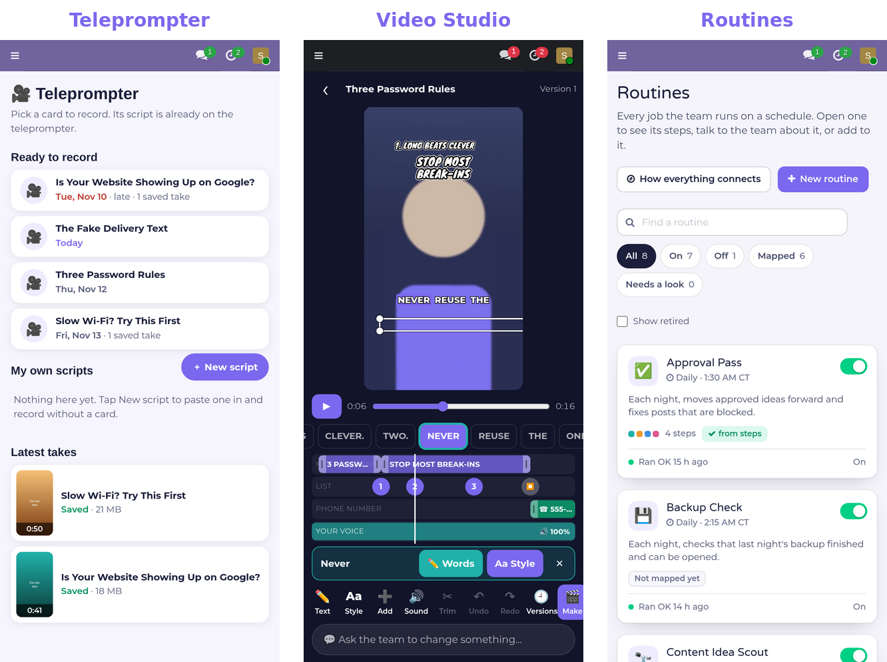
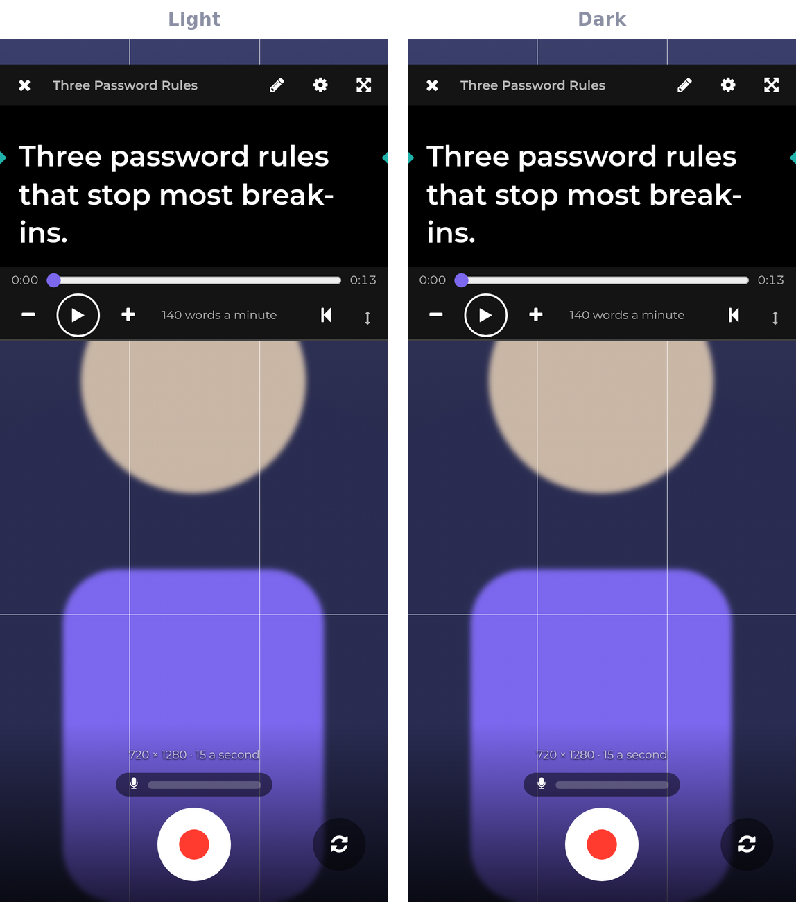
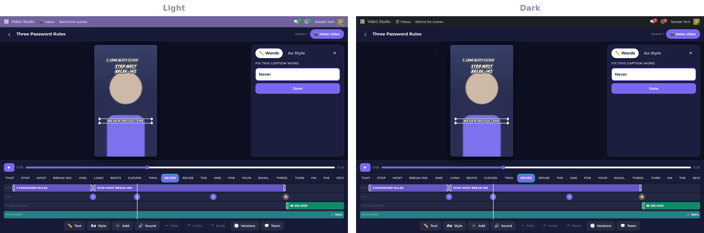
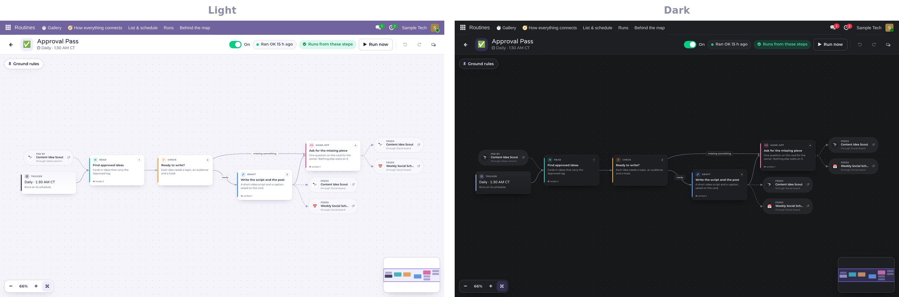
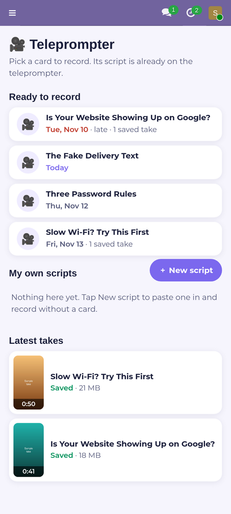
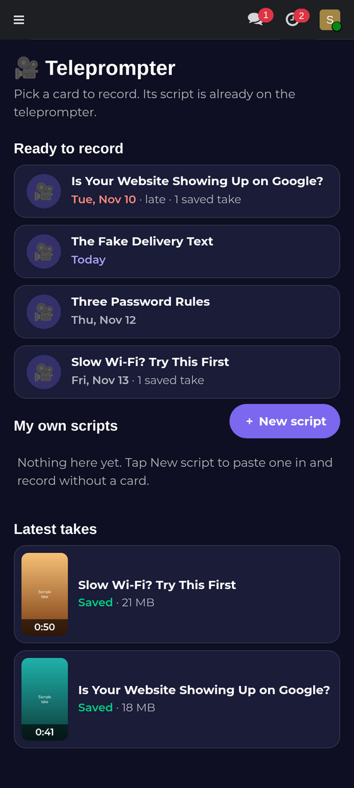
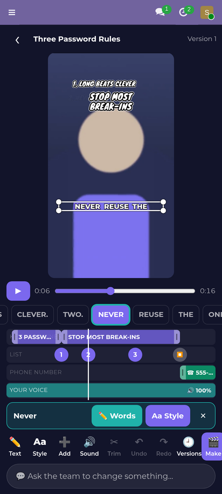
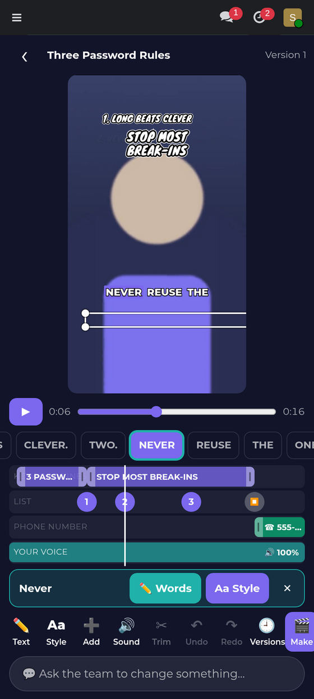
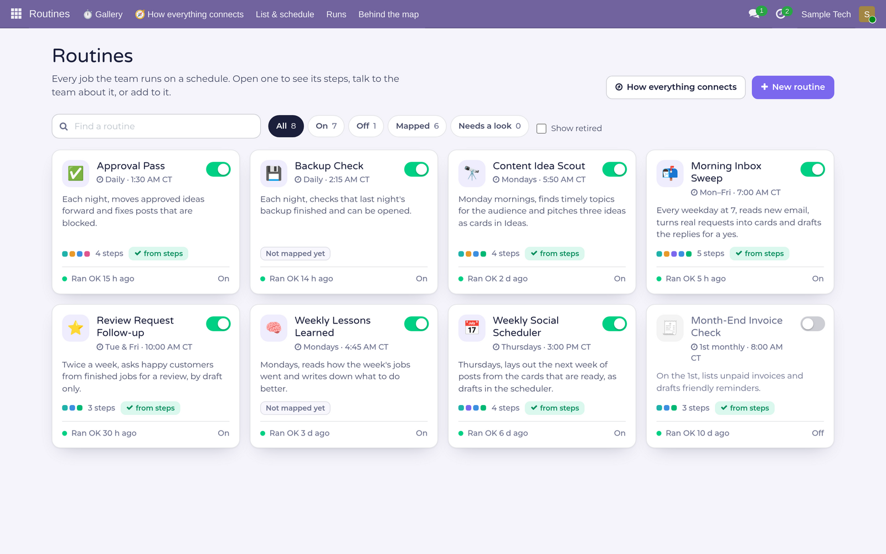
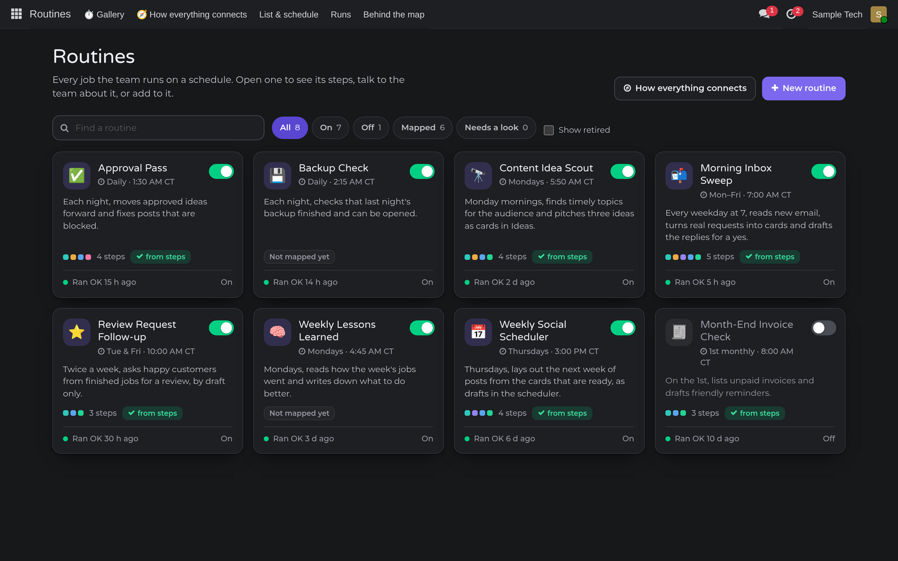

```
╔══════════════════════════════════════════════════════════════════════════════╗
║                                                                              ║
║  ████████╗██╗  ██╗███████╗   ███████╗████████╗██╗   ██╗██████╗ ██╗ ██████╗   ║
║  ╚══██╔══╝██║  ██║██╔════╝   ██╔════╝╚══██╔══╝██║   ██║██╔══██╗██║██╔═══██╗  ║
║     ██║   ███████║█████╗     ███████╗   ██║   ██║   ██║██║  ██║██║██║   ██║  ║
║     ██║   ██╔══██║██╔══╝     ╚════██║   ██║   ██║   ██║██║  ██║██║██║   ██║  ║
║     ██║   ██║  ██║███████╗   ███████║   ██║   ╚██████╔╝██████╔╝██║╚██████╔╝  ║
║     ╚═╝   ╚═╝  ╚═╝╚══════╝   ╚══════╝   ╚═╝    ╚═════╝ ╚═════╝ ╚═╝ ╚═════╝   ║
║                                                                              ║
║                     ▓▒░  LIGHTS · CAMERA · ROUTINE  ░▒▓                      ║
║              the creative suite that runs next to your AI team               ║
║                                                                              ║
╚══════════════════════════════════════════════════════════════════════════════╝
 > STUDIO.STATUS   TELEPROMPTER [LIVE]   VIDEO STUDIO [LIVE]   ROUTINES [LIVE]_
```

**The Studio is where the content gets made and the work gets planned.** Three programs that live inside Odoo, next
to your cards and your AI team: a teleprompter that records straight into the right folder, a video editor built
for the phone, and one place to see, change and create every routine the team runs.

Everything here is built and used every day to run a real business, not a demo.

`3 programs live` · `public showcase, private programs` · `Light and Dark` · `phone and desktop`



---

## The programs

| Program | Role | One line |
|---|---|---|
| **[Teleprompter](projects/teleprompter.md)** | record | Your script scrolls right next to the lens, and the take lands in the card's own folder, ready to edit. |
| **[Video Studio](projects/video-studio.md)** | edit | A phone-first video editor: fix a caption word, restyle any text, change the timing, then make the video. |
| **[Routines](projects/routines.md)** | plan | Every routine your AI team runs, as a map: change any step in plain English, or create a new routine from one sentence. |

### ▌ Teleprompter: record
Open a card that needs a video and press **Record this video**. The camera fills the screen and the card's script
scrolls in a box right next to the lens, so your eyes stay on the viewer. Speed, text size, countdown, grid lines
and front or back camera are a tap away, and a live sound meter shows your voice is coming through. Watch the take
back, keep it or go again. A kept take is saved into the card's own folder with a clear name, and one button tells
the team it is ready to edit.



### ▌ Video Studio: edit
The look your audience knows (a keyword line up top, word-by-word captions with the live word highlighted, a
numbered list, your phone number at the end) is editable right on the video. Tap any text to select it, drag it
into place, fix a caption word, change a keyword line or its timing, and pick the font, style, colour and size of
each layer. Tall or wide. Turn your voice up or down. Every change is a version you can go back to; the team can
make changes too, and they show up on your screen within seconds. One button makes the final video.



### ▌ Routines: plan
Every job your AI team runs on a schedule, in one gallery: its schedule, its on/off switch and how the last run
went. Open one and it is a map: what starts it, what it reads, checks, does, drafts and posts, and where it hands
off. Click a box to read or change that step in plain English. Describe a new step, a branch or a whole routine in
one sentence and the team drafts it as dashed boxes that go live only when you approve. Watch a run light up the
map as it happens, and see how every routine connects to the others.



---

## Built separate. Better together.

The Studio keeps the same promise as [The Grid](https://github.com/RobertAtParallax/the-grid): **every program is
useful alone, and better together.**

| You run | You get |
|---|---|
| **Teleprompter** | A teleprompter and recorder in Odoo, opened from a card or on its own. |
| **Teleprompter + Video Studio** | Record on the phone, edit on the phone, and the finished video goes back on the card. |
| **Routines** | Every scheduled job as a map you can read, change and create in plain English. |
| **The Studio + The Grid** | An always-on AI team that writes the scripts, cuts the videos, lines up the posts, and shows you every routine it runs. |

---

## What every program in The Studio shares

- **Lives where the work is.** Inside Odoo, next to the cards, the chats and the files.
- **Phone first, desktop friendly.** Every screen works one-handed on a phone and spreads out on a big screen.
- **Light and Dark.** Teleprompter and Routines follow your theme; the Video Studio editor is a dark studio in both.
- **Nothing is lost.** Takes, video versions and routine changes are all kept, and any of them can be brought back.
- **Humans stay in charge.** The team drafts; you approve. Nothing is published or sent without your yes.

---

## Light and Dark

| Light | Dark |
|---|---|
|  |  |
|  |  |
|  |  |

---

## The repositories

| Program | Visibility |
|---|---|
| The Studio | public (this showcase) |
| Teleprompter, Video Studio, Routines | private |

`projects/` holds a showcase page for each program, so the whole Studio can be read in one place. The programs
themselves, their code and their docs are private.

---

<sub>Built by Robert Richardson and his AI team at TechEase, Tyler, Texas. Teleprompter, Video Studio and Routines
© TechEase USA LLC. These programs run on Anthropic's Claude and are not affiliated with, endorsed by, or sponsored
by Anthropic. Screenshots use sample data.</sub>

```
 CUT. THAT'S A WRAP.
```
