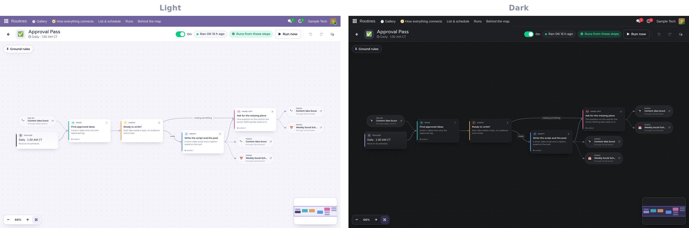
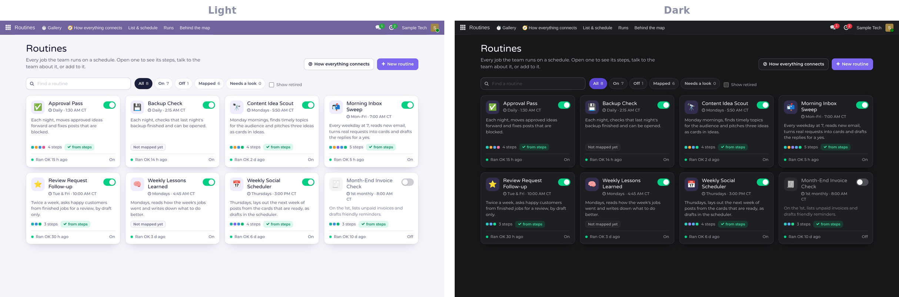
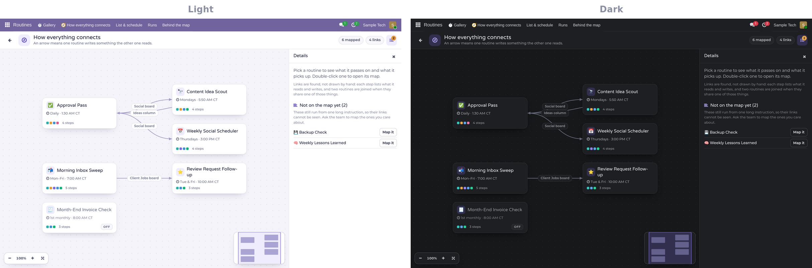

> Showcase page for **Routines**, one of the programs in [The Studio](../README.md). The program itself is private.

```
╔══════════════════════════════════════════════════════════════════════════════╗
║                                                                              ║
║                               R O U T I N E S                                ║
║                                                                              ║
║              ▓▒░  EVERY JOB THE TEAM RUNS, DRAWN AS A MAP  ░▒▓               ║
║               manage and create the routines your AI team runs               ║
║                                                                              ║
╚══════════════════════════════════════════════════════════════════════════════╝
 > STUDIO.BOOT   gallery [OPEN]   maps [DRAWN]   runs [WATCHED]_
```

# Routines

**Routines shows every job your AI team runs on a schedule, and lets you change any of them in plain English.**
Each routine is drawn as a map of boxes you can read at a glance, and the map is the routine: change a box and the
team's instructions change with it, so what you see is always what runs.

`desktop and phone` · Light and Dark



---

## What you get

**▌ A gallery of everything that runs**
- Every routine as a card: what it does in one line, its schedule, an on/off switch, and how the last run went.
- Find one by name, or filter to the ones that are on, off, mapped, or need a look.



**▌ Each routine as a map**
- What starts it, then each step as a box: **Read**, **Check**, **Do**, **Draft**, **Post** and **Hand-off**.
- Branches show which way the routine goes and when. Zoom, pan and a mini-map for big ones.
- **Click a box** to read the step in plain English, or change it.
- **➕ on any box:** describe a new step, a branch or a whole run of steps in a sentence. The team draws it as dashed
  boxes, and they go live only when you approve.

**▌ Create a routine from one sentence**
- Say what you want done and when. The routine is created switched off, the team maps it, and you approve it.

**▌ Watch a run happen**
- The step a run is on lights up, finished steps turn green, and a failed step turns red with the reason.
- A live log of what the team is doing, and the last few runs with their reports.

**▌ How everything connects**
- One view of every routine, with an arrow wherever one routine makes something another one uses, found from the
  steps themselves, never drawn by hand.



**▌ Nothing is lost**
- Every change is a saved version, with undo, redo and bring back.
- Talk to the team about a routine right next to its map.

## Built separate. Better together.
Routines draws the scheduled jobs of the AI team that lives in Odoo
([IO Tower on The Grid](https://github.com/RobertAtParallax/the-grid)). Teleprompter and Video Studio are where
the routines' video work lands.

<sub>Part of [The Studio](../README.md). Screenshots use sample data.</sub>
