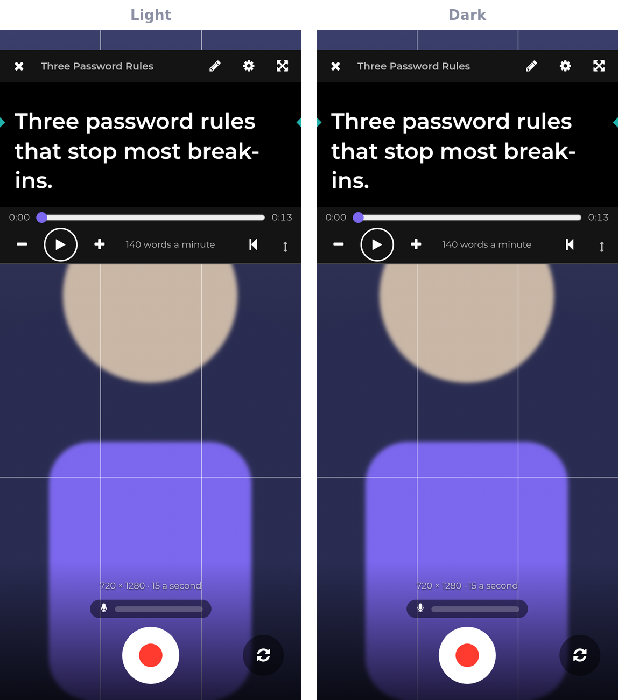
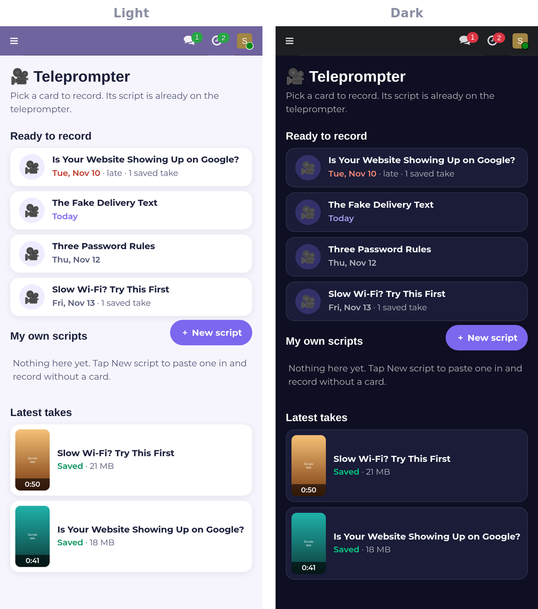
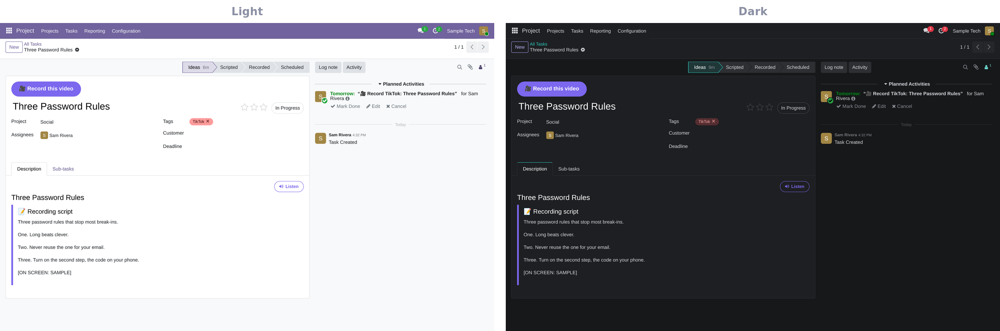

> Showcase page for the **Teleprompter**, one of the programs in [The Studio](../README.md). The program itself is private.

```
╔══════════════════════════════════════════════════════════════════════════════╗
║                                                                              ║
║                           T E L E P R O M P T E R                            ║
║                                                                              ║
║              ▓▒░  EYES ON THE LENS, WORDS RIGHT BESIDE IT  ░▒▓               ║
║             a teleprompter and recorder that lives on your cards             ║
║                                                                              ║
╚══════════════════════════════════════════════════════════════════════════════╝
 > STUDIO.BOOT   camera [READY]   script [LOADED]   mic [LIVE]_
```

# Teleprompter

**Teleprompter turns your phone into a teleprompter and a camera in one screen, opened right from the card that
needs the video.** The card's script scrolls next to the lens, you record, you keep the take, and it is saved where
the team will look for it. Nothing to install, no file to move, no script to copy, and on an Android phone it can
hand the recording to our phone app for a sharper, steadier picture.

`phone first` · works on desktop too · Light and Dark



---

## What you get

**▌ Opens from the card**
- Cards that need a video show **Record this video**, on the card and on the board.
- A home screen lists what is ready to record, with the dates, plus your own scripts and your latest takes.
- The script comes from the card itself. Stage notes in [brackets] stay off the screen, and you can change the
  words by hand before you start.



**▌ Built for looking at the lens**
- The camera fills the screen and the words scroll in a box right next to the lens.
- Set the speed in words a minute, the text size, the box height and where it sits, how dark it is, a countdown,
  grid lines, front or back camera and the video quality. Your settings stay on your phone.
- A live sound meter above the record button shows your voice is coming through.

**▌ Sharper and steadier on an Android phone**
- With our phone app installed, **Record** opens the app's own recorder with the same script scrolling by the lens.
- It records the way the phone's camera does: a steady 30 frames a second, focus that follows you, and steadying
  where the camera offers it, so the video does not stutter.
- The take goes to the same card folder with the same name and the same hand-off as any other take. Prefer the
  browser? One tap records there instead, this time or from now on.

**▌ Keep it or go again**
- Watch each take back, then **Keep** or **Record again**.
- A take with no sound is caught right away, with the three things to check.
- A kept take is sent in small pieces, so a weak signal does not lose it, and it is saved into the card's own
  folder with a clear name and the date. A note goes on the card.
- **Tell the team it is ready to edit** hands it on and closes your to-do.



## Built separate. Better together.
On its own, Teleprompter works in any Odoo with projects. With Video Studio, a kept take is the start of the edit.
With the AI team on [The Grid](https://github.com/RobertAtParallax/the-grid), the scripts are written for you and
the hand-off starts the edit.

<sub>Part of [The Studio](../README.md). Screenshots use sample data.</sub>
