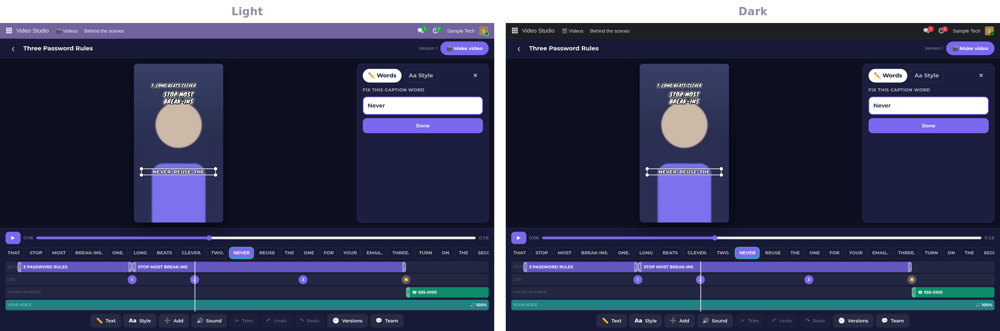
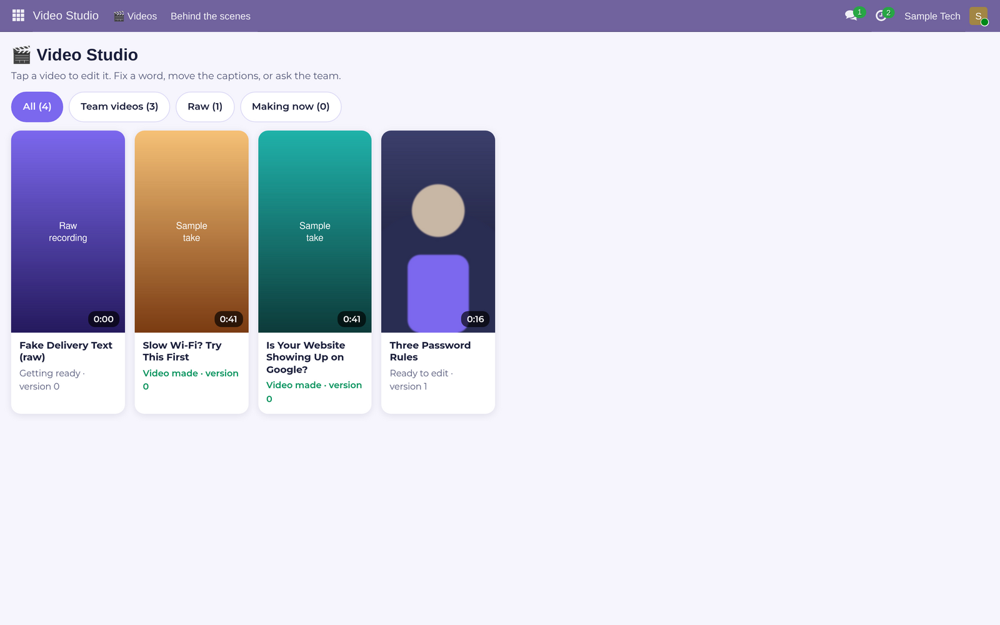
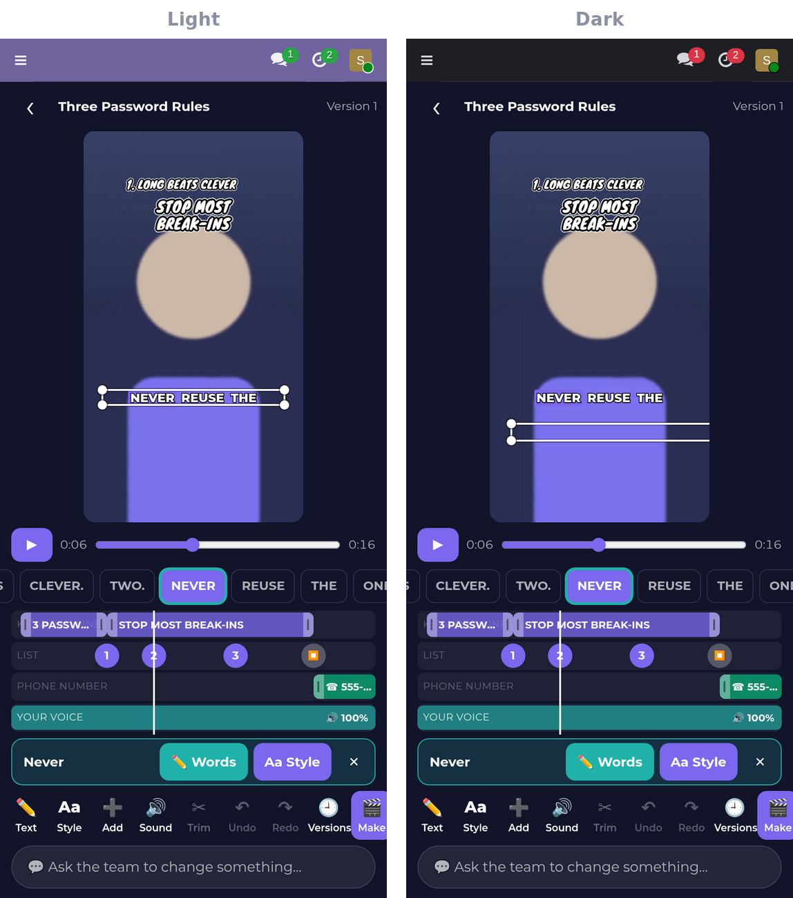

> Showcase page for **Video Studio**, one of the programs in [The Studio](../README.md). The program itself is private.

```
╔══════════════════════════════════════════════════════════════════════════════╗
║                                                                              ║
║                           V I D E O   S T U D I O                            ║
║                                                                              ║
║             ▓▒░  EVERY WORD ON SCREEN IS ONE TAP FROM A FIX  ░▒▓             ║
║                 a phone-first video editor for short videos                  ║
║                                                                              ║
╚══════════════════════════════════════════════════════════════════════════════╝
 > STUDIO.BOOT   preview [LIVE]   versions [KEPT]   render [READY]_
```

# Video Studio

**Video Studio is a video editor built for the phone, for the short videos a small business posts every week.**
The captions, keyword lines, numbered list and phone number sit on top of the video as text you can edit, so a
wrong word is a tap to fix instead of a whole new edit. What you see in the preview is exactly what the final video
will be.

`phone first` · desktop layout too · tall or wide



---

## What you get

**▌ Edit right on the video**
- **Tap any text** on the video to select it, and drag it where you want it.
- **Fix a caption word** where it was misheard, edit a keyword line or a list item, and change when each one
  shows up and goes away.
- **Add** a keyword line, a list item or the phone number at any moment.
- **Undo and redo**, plus a version for every change you can go back to.

**▌ Make it yours**
- A **Style** tab for each layer (captions, keyword lines, the list, the phone number): font, outline, shadow, box
  or plain, colour, highlight colour and size.
- **Tall or wide**: the same design fits a phone video or a widescreen one.
- **Voice volume**: turn your voice up or down without leaving the editor.

**▌ The team edits with you**
- Ask the team for a change in the chat beside the video. Their changes land as new versions and show on your
  screen within seconds.
- **Make video** renders the final file with a progress bar, and it goes back on the card it belongs to.

**▌ Phone and desktop**
- One-handed on a phone. On a computer, the preview sits in the middle, words, style, versions and the team chat at
  the side, and a timeline across the bottom, with the keyboard shortcuts you expect.





## Built separate. Better together.
With Teleprompter, a fresh recording is ready to edit on the same phone. With the AI team on
[The Grid](https://github.com/RobertAtParallax/the-grid), the first cut is made for you, and you only fix what you
want to.

<sub>Part of [The Studio](../README.md). Screenshots use sample data.</sub>
